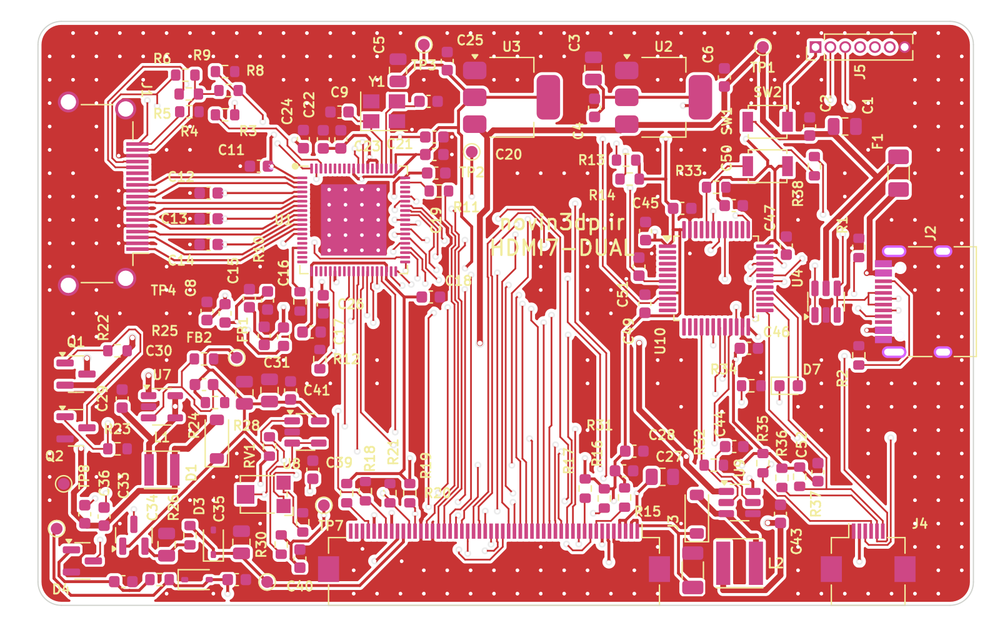

# HDMI7 دو-میکرو: STM32F072CBT6 یا CH32X035C8T6 روی یک جای نصب

این پروژه همان برد HDMI7 اصلی (`hardware/`، 80×50mm، USB-C در لبه‌ی راست) است، با یک فوت‌پرینت LQFP-48 (U10) که **هر دو میکرو** روی آن می‌نشینند. اول STM32F072 را نصب و برد را تست کنید، بعد آن را با هوای گرم بردارید و CH32X035C8T6 را جایش لحیم کنید.

> ⚠️ همه‌ی بررسی‌های نرم‌افزاری پاس شده‌اند (DRC بدون خطا و بدون اتصال باز، تطبیق شماتیک با PCB)، ولی برد هنوز ساخته و تست نشده است. **فرم‌ور CH32X035 هنوز نوشته نشده**؛ فرم‌ور فعلی فقط برای STM32F072 است.

## چرا یک فوت‌پرینت کافی است

پایه‌های اصلی دو تراشه در LQFP-48 یکی‌اند:

| پایه | STM32F072 | CH32X035C8T6 |
|---|---|---|
| 7 | NRST | PA21/RST |
| 32 / 33 | USB D− / D+ | USB D− / D+ |
| 34 / 37 | SWDIO / SWCLK | SWDIO / SWCLK |
| 47 / 48 | VSS / VDD | GND / VDD |

همه‌ی سیگنال‌های برد روی CH32 هم به یک GPIO قابل استفاده می‌رسند:

| پایه | سیگنال | STM32F072 | CH32X035 |
|---|---|---|---|
| 10 | HDMI5V_DET | PA0 | PA0 |
| 16 | BL_PWM | PA6 (TIM3_CH1) | PA6 (TIM3_CH1) |
| 18 / 19 / 20 | LCD_RST / LR / UD | PB0 / PB1 / PB2 | PC6 / PC7 / PB0 |
| 21 / 22 | TP_SCL / TP_SDA | PB10 / PB11 (I2C2) | PB1 / PB2 (I2C نرم‌افزاری) |
| 25 / 26 | TP_INT / TP_RST | PB12 / PB13 | PB5 / PB6 |
| 28 / 29 | LED / BIAS_EN | PB15 / PA8 | PB8 / PB9 |
| 30 / 31 | UART TX / RX | PA9 / PA10 (USART1) | PB10 / PB11 (USART1) |
| 41 | LT_RSTN | PB5 | PA9 |
| 42 / 43 | LT_SCL / LT_SDA | PB6 / PB7 (I2C1) | PA10 / PA11 (I2C نرم‌افزاری) |
| 44 | BOOT0 | BOOT0 | PA12 (استفاده نمی‌شود) |

I2C روی CH32 نرم‌افزاری است، چون I2C سخت‌افزاری آن در بعضی سری‌های تولید ایراد دارد.

**نکته‌ی مهم برای فرم‌ور CH32:** پایه‌های تغذیه‌ی STM32 (۱، ۸، ۹، ۲۳، ۲۴، ۳۵، ۳۶) روی CH32 پایه‌ی GPIO هستند (PA15، PA22، PA23، PB3، PB4، PB12، PB13) که به 3.3V یا زمین وصل شده‌اند. فرم‌ور CH32 **هرگز نباید این پایه‌ها را خروجی کند**؛ بعد از ریست ورودی هستند و همین‌طور باید بمانند.

## بوت‌لودر

* **STM32F072:** دکمه‌ی SW1 (BOOT0) را نگه دارید و USB را وصل کنید ← DFU.
* **CH32X035:** دکمه‌ی SW2 را نگه دارید و USB را وصل کنید. SW2 پایه‌ی D+ (PC17) را از طریق R38 (4.7k) به 3.3V می‌برد و تراشه وارد بوت‌لودر USB می‌شود (WCHISPTool یا `wchisp`). برنامه‌ریزی با WCH-LinkE روی هدر J5 (SWDIO/SWCLK) هم ممکن است. SW2 روی STM32 بی‌اثر است.

## تعویض میکرو

1. با STM32F072 و فرم‌ور `firmware/` (`make`) برد را کامل تست کنید.
2. STM32 را با هوای گرم بردارید، پدها را با فتیله تمیز کنید.
3. CH32X035C8T6 را با **همان جهت پایه‌ی ۱** لحیم کنید.

## ساخت

`fab/lcd_dual_gerbers.zip`، `fab/bom_jlcpcb.csv` (با STM32F072)، `fab/cpl_jlcpcb.csv`؛ شماتیک: `docs/schematic_dual.pdf`. برای ساخت دوباره، اسکریپت‌های `hardware_dual/gen` مثل بخش ۱۰ README اصلی اجرا می‌شوند.
